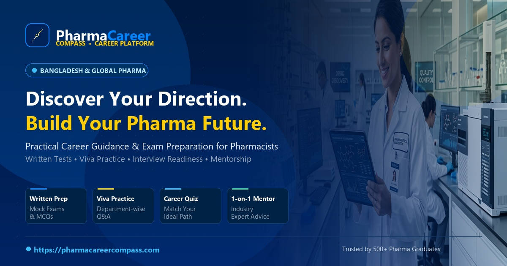

# Pharma Career Compass (🧭)

<p align="center">
  
</p>

<p align="center">
  <strong>Discover Your Direction. Build Your Future.</strong><br>
  <em>The dedicated career preparation, examination, and mentorship platform for pharmacists, graduates, and life-science professionals.</em>
</p>

<p align="center">
  <a href="https://pharmacareercompass.com"></a>
  <a href="https://github.com/EngrSaad2/pharma-Career-Focus"></a>
  
  
  
  
</p>

---

## 🌐 Live Production

- **Domain**: [https://pharmacareercompass.com](https://pharmacareercompass.com)
- **Status**: Live on Hostinger LiteSpeed + Cloudflare Edge
- **Flagship Cohort**: **PHARMA CAREER LAUNCHPAD**
- **Core Pillars**: *Career Planning • Written Exam Prep • Viva Practice • Interview Readiness • 1-on-1 Mentorship*

---

## 🌟 Comprehensive Feature Catalog

### 1. 🧭 The 5 Core Pillars of Preparation

| Pillar | Feature | Highlights |
|---|---|---|
| **Pillar 1: Career Planning** | **AI-Guided Career Assessment Quiz (`/quiz`)** | 5-step diagnostic evaluating academic qualifications, career stages, work style, and industry interests. Automatically calculates weighted match scores across 11 pharmaceutical disciplines and delivers top 3 tailored recommendations with a 4-step action plan. |
| **Pillar 2: Sector Roadmaps** | **Interactive Career Roadmap Builder (`/roadmap`)** | Personalized phase-by-phase roadmaps (Foundation, Technical Core, Industry Compliance, Interview Mastery). Users can check off milestones and persist progress directly into their candidate account. |
| **Pillar 3: Written Exam Prep** | **Pharma Exam Simulator (`/practice/exams`)** | Real-time mock tests for Quality Assurance, QC, Production, and Regulatory Affairs. Features timer countdowns, randomized questions, instant grading, score breakdown, and comprehensive question rationale explanations. |
| **Pillar 4: Viva Practice** | **Departmental Viva Master Hub (`/practice/viva`)** | High-yield oral board questions covering pharmacopoeial standards (USP, BP), cGMP, HVAC, HPLC/GC chromatography, autoclave validation, and dossier filings. Includes model answers and toggleable master checklists. |
| **Pillar 5: Interview Readiness** | **Technical & HR Interview Prep (`/practice/interviews`)** | Industrial job interview prompts structured with the **STAR Method** (Situation, Task, Action, Result), evaluation criteria, interviewer red flags, and practice tracking. |

---

### 2. 🔬 11 Pharmaceutical Industry Sectors Covered

Detailed pathways with required degree criteria, core responsibilities, salary trends, career progression ladders, and recommended preparation milestones:

1. **Quality Assurance (QA)** — Validation, qualification, batch record review, deviations, CAPA, change control, and cGMP compliance.
2. **Quality Control (QC)** — Wet chemistry, instrumental analysis (HPLC, GC, UV-Vis, FTIR), stability testing, and microbial assays.
3. **Production & Manufacturing** — Solid dosage (granulation, compression, coating), sterile injectables, liquid syrups, and packaging lines.
4. **Regulatory Affairs (RA)** — CTD/eCTD dossier compilation, DGDA registration, export compliance, variation filings, and pharmacovigilance reports.
5. **Research & Development (R&D / Formulation)** — Pre-formulation, reverse engineering, pilot trial optimization, and tech transfer.
6. **Pharmacovigilance (PV)** — Adverse drug reaction (ADR) reporting, safety signal detection, and periodic safety update reports (PSUR).
7. **Medical Affairs & Scientific Communications** — Medical writing, KOL engagement, clinical trial reviews, and advisory board management.
8. **Product Management & Marketing (PMD)** — Brand strategy, physician detailing aids, product launches, market research, and campaigns.
9. **Clinical Research & Trials** — GCP compliance, clinical trial monitoring (CRA), protocol design, and ethics committee submissions.
10. **Hospital & Clinical Pharmacy** — Prescription validation, therapeutic drug monitoring (TDM), clinical rounds, and adverse reaction surveillance.
11. **Supply Chain & Procurement** — API/excipient sourcing, cold-chain logistics, GDP compliance, and inventory forecasting.

---

### 3. 🤝 1-on-1 Mentorship & Booking Engine

- **Industry Consultant Directory (`/consultants`)**: Detailed mentor profiles with degrees, industrial tenure (Square, Incepta, Beximco, Renata, etc.), sector specialties, and transparent hourly rates.
- **7 Tailored Consultation Packages (`/services`)**:
  - *Career Clarity & Path Selection* (30 mins)
  - *Industrial CV & LinkedIn Makeover* (45 mins)
  - *Quality Assurance & QC Technical Drill* (60 mins)
  - *Regulatory Affairs Dossier Prep* (60 mins)
  - *Mock Technical Viva Session* (45 mins)
  - *Full Job Interview Simulation* (60 mins)
  - *Executive Career Strategy & Promotion Guidance* (60 mins)
- **Live Scheduling & Anti-Double-Booking**: Real-time slot availability calculator via AJAX based on consultant weekly schedules. Prevents double-bookings and generates unique meeting codes.
- **Automated Video Meeting Links**: Instant booking confirmation (`/consultation/confirmation/{id}`) with meeting links, calendar integration, and reminder notifications.

---

### 4. 📊 Candidate Interactive Dashboard (`/dashboard`)

- **Dashboard Overview**: Visual progress rings, completed milestone counter, mock exam score averages, and upcoming video consultations.
- **Assessment History (`/dashboard/assessment`)**: Past career assessment results, sector fit scores, and action plans.
- **My Roadmap (`/dashboard/roadmap`)**: Interactive checklist with persistent milestone completion tracking.
- **Exam Performance Records (`/dashboard/exams`)**: Historical test attempts, scorecards, time taken, and answer reviews.
- **Viva & Interview Tracker (`/dashboard/viva`)**: Mark prompts as "Mastered" to monitor viva and interview readiness.
- **Bookings Management (`/dashboard/bookings`)**: Manage upcoming sessions, join video links, and review cancellation policies.
- **Profile & Preferences (`/dashboard/profile`)**: Manage degree details, graduation year, target sector, and credentials.

---

### 5. 🛡️ Administrative Suite (`/admin`)

Full back-office control for platform administrators:

- **Analytics Dashboard**: Real-time KPI cards for candidates, bookings, active mentors, exams taken, and contact queries.
- **Consultation Bookings Manager (`/admin/bookings`)**: View, approve, cancel, reschedule, and update meeting URLs.
- **Services Manager (`/admin/services`)**: Create and update consultation packages, pricing, durations, and benefits.
- **Career Paths Editor (`/admin/career-paths`)**: Manage the 11 pharmaceutical disciplines, skills, and roadmaps.
- **Consultants Manager (`/admin/consultants`)**: Manage verified mentors, bios, photos, and weekly availability slots.
- **Exam Question Bank (`/admin/exams`)**: Manage MCQ categories, questions, options, correct answers, and explanations.
- **Viva Question Bank (`/admin/viva`)**: Add and categorize departmental viva questions with expert model answers.
- **Blog & Article CMS (`/admin/blog`)**: Create, edit, tag, and publish career guidance articles.
- **Testimonial Management (`/admin/testimonials`)**: Manage student feedback with explicit demonstration indicators.
- **FAQ Manager (`/admin/faqs`)**: Organize frequently asked questions by topic and display priority.
- **Inquiries Center (`/admin/messages`)**: View contact form submissions and reply directly.
- **Global Settings (`/admin/settings`)**: Update site branding, top announcement ticker marquee, contact info, and social channels.

---

### 6. 🚀 SEO & Open Graph Social Sharing

Optimized to comply with **Google Search Algorithm** guidelines and **Facebook Sharing Debugger** standards:

- **1200x630 Social Preview Card**: Pixel-perfect high-contrast banner (`public/images/og-pharma-compass.jpg`) matching Facebook, LinkedIn, Twitter, and WhatsApp aspect ratio (1.91:1).
- **Google SERP Titles**: High-intent title `< 60` characters (*"Pharma Career Compass | Pharma Career Guidance & Exam Prep"*).
- **Compelling Meta Description**: 160-character description with optimal CTR keywords and zero search snippet truncation.
- **Social Graph Tags**:
  - `og:site_name`, `og:title`, `og:description`, `og:url`, `og:type` (`website`), `og:locale` (`en_US`)
  - `og:image`, `og:image:secure_url`, `og:image:width` (1200), `og:image:height` (630), `og:image:type` (`image/jpeg`)
  - `twitter:card` (`summary_large_image`), `twitter:title`, `twitter:description`, `twitter:image`
- **Structured Data (JSON-LD)**: Schema.org `EducationalOrganization` with official contact points, social profiles, and site search metadata.
- **Search Engine Discovery**: Dynamic XML sitemap generator at `/sitemap.xml` and compliant `/robots.txt`.

---

## 🔑 Demo Access Credentials

The database is pre-seeded with ready-to-test role accounts:

| Role | Email | Password | Access Rights |
|---|---|---|---|
| **Administrator** | `admin@pharmacareer.com` | `password` | Complete Back-Office (`/admin`) + Candidate Portal |
| **Consultant** | `consultant@pharmacareer.com` | `password` | Consultant Profile + Candidate Portal |
| **Candidate / Student** | `student@pharmacareer.com` | `password` | Candidate Dashboard (`/dashboard`) + Practice Hub |

---

## 💻 Tech Stack

- **Backend**: Laravel 11 / 12 (PHP 8.2+)
- **Database**: MySQL 8.0 / MariaDB (InnoDB, Foreign Key Integrity)
- **Frontend / Styling**: Tailwind CSS v4, Alpine.js, Plus Jakarta Sans typography
- **Asset Bundler**: Vite 7
- **Architecture**: MVC with dedicated Service & Repository layers
- **Testing**: PHPUnit feature test suite (18 test cases, 60 assertions)
- **Deployment**: LiteSpeed Web Server, PHP 8.3/8.4 CLI, Cloudflare SSL/CDN

---

## ⚙️ Local Development Setup

### 1. Prerequisites
- PHP 8.2+ with `pdo_mysql`, `mbstring`, `openssl`, `curl` extensions
- Composer 2+
- Node.js 18+ & npm
- MySQL / MariaDB

### 2. Clone and Install Dependencies
```bash
git clone https://github.com/EngrSaad2/pharma-Career-Focus.git
cd pharma-Career-Focus

# Install PHP packages
composer install

# Install Frontend dependencies
npm install
```

### 3. Environment Setup
```bash
# Copy example environment file
cp .env.example .env

# Generate application encryption key
php artisan key:generate
```

Configure database credentials in `.env`:
```env
DB_CONNECTION=mysql
DB_HOST=127.0.0.1
DB_PORT=3306
DB_DATABASE=pharmacareer
DB_USERNAME=root
DB_PASSWORD=
```

### 4. Database Setup & Seeding
```bash
# Create local database (MySQL console):
mysql -u root -e "CREATE DATABASE IF NOT EXISTS pharmacareer CHARACTER SET utf8mb4 COLLATE utf8mb4_unicode_ci;"

# Run migrations and seed complete demonstration dataset
php artisan migrate:fresh --seed
```

### 5. Build Assets & Storage Link
```bash
# Build frontend assets
npm run build

# Link storage directory
php artisan storage:link
```

### 6. Start Development Server
```bash
php artisan serve
```
Visit `http://localhost:8000` in your web browser.

---

## 🧪 Automated Test Suite

Run the full automated test suite covering all features, auth flows, quizzes, mock tests, and admin protections:

```bash
php artisan test
```

```
   PASS  Tests\Feature\ExampleTest
  ✓ the application returns a successful response                        0.14s

   PASS  Tests\Feature\PharmaCareerFeatureTest
  ✓ home page renders successfully                                       0.08s
  ✓ career paths directory renders successfully                          0.05s
  ✓ services catalog renders successfully                                0.05s
  ✓ consultants directory renders successfully                           0.05s
  ✓ career quiz page renders successfully                                0.05s
  ✓ career quiz submission returns recommendations                      0.09s
  ✓ roadmap page renders successfully                                    0.05s
  ✓ exam practice hub renders successfully                               0.05s
  ✓ take exam page renders successfully                                  0.06s
  ✓ viva practice hub renders successfully                               0.05s
  ✓ interview practice hub renders successfully                          0.05s
  ✓ booking page renders successfully                                    0.05s
  ✓ booking submission creates record                                    0.11s
  ✓ guest cannot access user dashboard                                   0.04s
  ✓ authenticated user can access dashboard                              0.08s
  ✓ guest cannot access admin dashboard                                  0.04s
  ✓ regular user cannot access admin dashboard                           0.07s
  ✓ admin user can access admin dashboard                                0.12s

  Tests:    18 passed (60 assertions)
  Duration: 1.34s
```

---

## 🚀 Production Deployment Reference

Production credentials and automation commands are documented in the server skill:
- **Server Skill**: [pharmacareercompass-server](file:///C:/Users/Admin/.gemini/config/skills/pharmacareercompass-server/SKILL.md)
- **Live Server IP**: `46.28.47.75:65002`
- **Remote App Path**: `/home/u263680919/domains/pharmacareercompass.com/public_html`

### Quick Sync Command:
```bash
python -c "
import paramiko
client = paramiko.SSHClient()
client.set_missing_host_key_policy(paramiko.AutoAddPolicy())
client.connect('46.28.47.75', port=65002, username='u263680919', password='mDrasel477@!', timeout=15)
cmd = 'cd /home/u263680919/domains/pharmacareercompass.com/public_html && git fetch origin && git reset --hard origin/main && php artisan optimize:clear && php artisan config:cache && php artisan route:cache && php artisan view:cache'
stdin, stdout, stderr = client.exec_command(cmd)
print(stdout.read().decode())
client.close()
"
```

---

## 📄 License & Attribution

- **Project**: Pharma Career Compass
- **Developed for**: Pharmaceutical graduates, students, and life-science professionals worldwide.
- **Repository**: [https://github.com/EngrSaad2/pharma-Career-Focus](https://github.com/EngrSaad2/pharma-Career-Focus)
